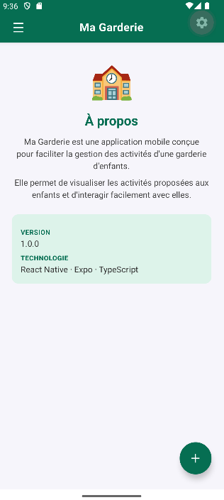

Ma Garderie

Application mobile **React Native / Expo / TypeScript** pour la gestion des activités d'une garderie d'enfants.

---

## 📱 Aperçu

| Splash Screen | Accueil | Activités | À propos |
|:---:|:---:|:---:|:---:|
|  |  |  |  |

---

 Fonctionnalités

- **Splash screen animé** — logo + titre affiché 3 secondes au démarrage
- **AppBar verte** — avec bouton hamburger pour ouvrir le drawer
- **Drawer de navigation** — 3 sections : Accueil, Activités, À propos
- **Liste d'activités** — FlatList avec cartes cliquables et animation spring au press
- **FAB (Floating Action Button)** — bouton `+` vert en bas à droite
- **Section À propos** — informations sur l'application
- **Alertes interactives** — feedback visuel sur chaque interaction

---

 Architecture

```
garderie-mobile/
├── App.tsx                    # Point d'entrée — gestion splash/home
├── index.ts                   # Entrypoint Expo
├── app.json                   # Configuration Expo
├── tsconfig.json              # Configuration TypeScript
│
├── components/
│   ├── SplashScreen.tsx       # Écran de démarrage
│   ├── HomeScreen.tsx         # Écran principal (AppBar + FlatList + FAB)
│   └── DrawerMenu.tsx         # Menu latéral de navigation
│
├── types/
│   └── index.ts               # Types partagés (Activity, DrawerSection)
│
├── assets/
│   ├── icon.png
│   ├── splash-icon.png
│   ├── favicon.png
│   └── android-icon-*.png
│
└── screenshots/               # Captures d'écran de l'application
```

---
 Charte graphique

| Élément | Couleur |
|---|---|
| Vert principal | `#066E52` |
| Vert clair (fond splash, banners) | `#DDF3EA` |
| Fond général | `#F6F5FB` |
| Texte principal | `#1a1a1a` |
| Texte secondaire | `#666` |

---

 Installation et démarrage

### Prérequis

- [Node.js](https://nodejs.org/) v18 ou supérieur
- [Expo CLI](https://docs.expo.dev/get-started/installation/) : `npm install -g expo-cli`
- [Expo Go](https://expo.dev/client) sur votre appareil mobile (iOS ou Android)

### Étapes

```bash
# 1. Cloner le dépôt
git clone https://github.com/manellt/garderie-mobile.git
cd garderie-mobile

# 2. Installer les dépendances
npm install

# 3. Lancer l'application
npx expo start
```

Scannez ensuite le QR code avec **Expo Go** (Android) ou l'appareil photo (iOS).

---

##  Branches Git

| Branche | Objectif |
|---|---|
| `feature/init-project` | Initialisation du projet Expo TypeScript |
| `feature/splash-screen` | SplashScreen personnalisé |
| `feature/home-page` | HomeScreen complet (AppBar, Drawer, FAB, sections) |
| `feature/list-view` | Types TypeScript centralisés (`types/index.ts`) |
| `feature/interactions` | Animations spring + messages d'alerte améliorés |
| `docs/readme` | Documentation et captures d'écran |

Chaque branche a été mergée dans `main` avec `--no-ff` pour conserver l'historique.

---

## Stack technique

| Technologie | Version |
|---|---|
| React Native | 0.88.0 |
| Expo | ~58.0.16 |
| TypeScript | ~6.0 |
| Node.js | v22.19.0 |

---

##  Auteur

Développé par **manel* ([manellt](https://github.com/manellt)) dans le cadre d'un projet pédagogique.

---

## 📄 Licence

MIT — voir le fichier [LICENSE](LICENSE).
